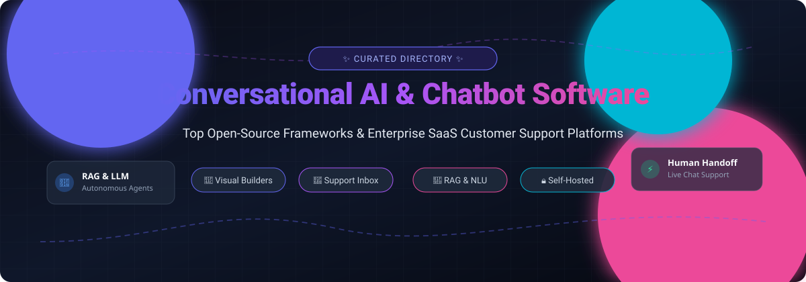

<div align="center">

<p align="center">
  
</p>

# 🤖 Awesome Conversational AI & Chatbot Software

<p align="center">
  <a href="https://github.com/ishandutta2007/Awesome-Awesome-Awesome"></a><a href="https://discord.gg/jc4ttF58Ve"></a>
  <a href="https://github.com/ishandutta2007/Awesome-Awesome-Awesome"></a>
  <a href="https://github.com/ishandutta2007/Awesome-Conversational-AI-Chatbot-Software/stargazers"></a>
  <a href="#how-to-contribute"></a>
  <a href="LICENSE"></a>
  <a href="https://github.com/ishandutta2007"></a>
</p>

> 🌟 A curated directory of the best **Conversational AI platforms**, **AI chatbot software**, **open-source customer support inboxes**, **RAG knowledge engines**, and **visual flow builders**.

**Last updated: November 2026** 📅

</div>

---

## 📑 Table of Contents

- [📊 Sector Overview & Market Dynamics](#-sector-overview--market-dynamics)
- [⚖️ Quick Comparison: Open Source vs SaaS](#️-quick-comparison-open-source-vs-saas)
- [☁️ SaaS & Hosted Conversational AI Platforms](#️-saas--hosted-conversational-ai-platforms)
- [🔓 Open-Source Chatbot & Support Projects](#-open-source-chatbot--support-projects)
- [🏗️ Architecture & Selection Guide](#️-architecture--selection-guide)
- [🤝 How to Contribute](#-how-to-contribute)
- [☕ Support](#-support)
- [📈 Star History](#-star-history)
- [⚠️ Disclaimer](#️-disclaimer)

---

## 📊 Sector Overview & Market Dynamics

The global conversational AI and chatbot software market is estimated at **$13.2B – $14.4B in 2024–2026**, on pace to surpass **$40B+ by 2030** at a rapid **CAGR of ~22%** driven by generative LLM adoption and automated customer support resolutions. 

The industry remains **highly fragmented**: rather than a winner-take-all monopoly, the market is divided between major cloud infrastructure providers (Microsoft, Google, AWS), established enterprise CRM suites consolidating AI agents (HubSpot, Zendesk, Salesforce), specialized mid-market marketing engines (Drift, Qualified, ManyChat), and vibrant open-source orchestration frameworks (Dify, Open WebUI, Chatwoot, Rasa) delivering data sovereignty and zero vendor lock-in.

---

## ⚖️ Quick Comparison: Open Source vs SaaS

| Category | Primary Focus | Representative Solutions | Best For |
|:---|:---|:---|:---|
| **Enterprise SaaS Support** 🏢 | Turnkey AI agents + omnichannel ticket inbox | Zendesk AI, Intercom, Ada | Fast enterprise rollout, automated SLAs, managed cloud |
| **B2B Marketing & Sales SDR** 🎯 | Inbound visitor identification, calendar booking, lead routing | HubSpot Chatbots, Drift, Qualified | Revenue teams accelerating inbound pipeline |
| **Social & E-commerce Chatbots** 🛍️ | Automated messaging on Instagram, WhatsApp, Messenger, SMS | ManyChat, Chatfuel, Tidio | Direct-to-consumer brands and social marketing funnels |
| **Self-Hosted Support Inbox** 📬 | Multi-channel inbox with human agent handoff & bots | Chatwoot, Chaskiq | Total data ownership, HIPAA/GDPR privacy compliance |
| **Visual LLM Builders & Agents** 🎨 | Canvas-based prompt/flow orchestration & RAG pipelines | Dify, Flowise, Botpress | Complex multi-turn autonomous AI agent workflows |
| **Developer NLU & Model Training** 🧠 | On-premise intent classification & dialogue management | Rasa | Financial institutions & regulated on-prem ML environments |

---

## ☁️ SaaS & Hosted Conversational AI Platforms

The following SaaS platforms are ranked in descending order by estimated company valuation / annual revenue scale:

| Platform 🚀 | Company Scale (Valuation / Revenue) 💰 | Pricing Model & Starting Tier 🏷️ | Free Tier Limits & Free Trial Details 🎁 | Key Highlights & Best For 🎯 |
|:---|:---|:---|:---|:---|
| **[HubSpot Chatbot Builder](https://www.hubspot.com/)** | **~$28B+ Valuation** / ~$3.7B ARR | Free CRM tier included; Starter tier starts at **$15/seat/month**; Pro at **$450/month** | **Permanent Free Tier**: Unlimited contacts, rule-based Chatflows, ticketing, live chat widget (up to 2 free seats). 14-day trials on Pro tools. | Seamless CRM data synchronization, lead capture workflows, and native marketing automation. |
| **[Zendesk AI](https://www.zendesk.com/)** | **$10.2B Valuation** (Private buyout) / ~$2.0B ARR | Support Team starts at **$19/agent/month** (billed annually) or $25/mo; Suite Team at **$55/agent/month** | **No permanent free tier**. Offers a **14-day free trial** with full Suite Professional feature access (no credit card required). | Industry-standard enterprise helpdesk, SLA tracking, and multi-tier agent ticketing. |
| **[Intercom](https://www.intercom.com/)** | **$3.6B Valuation** / ~$400M+ ARR | Essential plan starts at **$29/seat/month** (annual) or $39/mo; Fin AI Agent at **$0.99/resolution** | **No permanent free tier**. Offers a **14-day free trial** with full platform and Fin AI Agent access (no credit card required). | Premium AI-first customer service with Fin autonomous agent resolution and live inbox. |
| **[Ada](https://www.ada.cx/)** | **$1.2B+ Unicorn** / ~$70M–$100M ARR | AWS Marketplace entry at **$33,000/year** (60k conversations); Enterprise plans starting at **$60,000+/year** | **No permanent free tier and 0-day free trial**. Custom evaluation via guided enterprise proof-of-concept only. | Autonomous AI customer service agents handling complex multi-system transactions and CRM actions. |
| **[Drift](https://www.drift.com/)** *(Salesloft)* | **~$1.0B+ Acquisition** / ~$60M–$80M ARR | Premium plan starts at **$2,500/month** (~$30,000/year annual contract); Advanced plans $40,000+/year | **No permanent free tier and 0-day free trial**. Requires enterprise sales consultation and demo. | Conversational marketing, automated meeting booking, and real-time B2B buyer routing. |
| **[Qualified](https://www.qualified.com/)** | **~$1.0B Unicorn** / ~$40M–$60M ARR | Enterprise contract packages starting at **$3,000/month** (~$36,000/year annual agreement) | **No permanent free tier and 0-day free trial**. Evaluation via sales demonstration and sandbox pilots. | AI SDR pipeline generation built specifically around Salesforce CRM account intelligence. |
| **[LivePerson](https://www.liveperson.com/)** | **~$350M–$450M Revenue** (NASDAQ: LPSN) | Starter package starts at **$599/month** (annual contract for up to 2,000 conversations/month) | **No permanent free tier**. Offers no self-serve free trial; custom sandbox access via enterprise sales only. | Large-scale contact center messaging transformation and omnichannel customer engagement. |
| **[ManyChat](https://manychat.com/)** | **~$200M–$300M+ Valuation** (Summit Partners) / ~$50M ARR | Pro tier starts at **$15/month** (scales by active contact list size, e.g. up to 500 contacts) | **Permanent Free Tier**: Capped at **25 active contacts/month**, 4 live automations, 1 user seat, Meta/Telegram channels. 14-day trial on Pro. | Social commerce campaigns and automated DM funnels across Instagram, WhatsApp, and Facebook. |
| **[Tidio](https://www.tidio.com/)** | **~$100M+ Valuation** / ~$15M–$25M ARR | Starter tier starts at **$29/month**; Growth tier at **$59/month**; Lyro AI bundles from $39/month | **Permanent Free Tier**: Up to **50 conversations/month**, 100 flow triggers, 50 lifetime Lyro AI responses, 10 agent seats. 7-day Pro trial. | Lightweight live chat widgets, visual bot builder, and quick Lyro AI customer service for SMBs. |
| **[Chatfuel](https://chatfuel.com/)** | **~$30M–$50M Valuation** / ~$10M ARR | Business tier starts at **$20/month** (or $29/mo billed monthly) for 500 conversations | **No permanent free tier**. Offers a **7-day free trial** with access to automated social flows and AI agents. | Rapid no-code bot creation for Meta social channels, automated e-commerce replies, and lead capture. |

---

## 🔓 Open-Source Chatbot & Support Projects

The following open-source repositories are sorted in descending order by **GitHub Stars_Count** 🌟. Beside each name is a badge showing live star numbers and linking directly to that project's stargazers:

| Repository 📦 | GitHub_Stars 🌟 | License 📄 | Tech Stack 💻 | Architecture & Deployment 🚀 | Best For 💡 |
|:---|:---:|:---|:---|:---|:---|
| **[Dify](https://github.com/langgenius/dify)** | [](https://github.com/langgenius/dify/stargazers) | Apache-2.0 | Python, Next.js, Celery, PostgreSQL | Self-hosted (Docker, Kubernetes) or Dify Cloud | Production-grade LLM app studio, visual RAG agent orchestrator, and multi-model conversational workflows. |
| **[Open WebUI](https://github.com/open-webui/open-webui)** | [](https://github.com/open-webui/open-webui/stargazers) | Open WebUI | Python, Svelte, Ollama / OpenAI API | Self-hosted (Docker Compose, Kubernetes) | Extensible self-hosted conversational AI interface with offline Ollama inference, RAG, and web browsing. |
| **[Lobe Chat](https://github.com/lobehub/lobe-chat)** | [](https://github.com/lobehub/lobe-chat/stargazers) | Apache-2.0 | TypeScript, Next.js, React | Self-hosted (Vercel, Docker, Zeabur) | Modern multi-modal agent chat framework with visual plugin system, TTS/STT, and custom agent marketplaces. |
| **[Flowise](https://github.com/FlowiseAI/Flowise)** | [](https://github.com/FlowiseAI/Flowise/stargazers) | MIT | TypeScript, Node.js, LangChain | Self-hosted (npm, Docker, Render) | Drag-and-drop node UI for building LangChain/LlamaIndex agents, custom chatbots, and document vector search. |
| **[LibreChat](https://github.com/LibreChat-AI/LibreChat)** | [](https://github.com/LibreChat-AI/LibreChat/stargazers) | MIT | Node.js, React, MongoDB, Docker | Self-hosted (Docker, Helm) | All-in-one ChatGPT clone supporting multi-provider LLMs, Code Interpreter, artifacts, and multi-user authentication. |
| **[Chatwoot](https://github.com/chatwoot/chatwoot)** | [](https://github.com/chatwoot/chatwoot/stargazers) | MIT | Ruby on Rails, Vue.js, PostgreSQL, Redis | Self-hosted (Docker, Kubernetes, 1-Click) / Cloud | The definitive open-source Intercom alternative: omnichannel inbox, Captain AI assistant, live chat widget, and human handoff. |
| **[MaxKB](https://github.com/1Panel-dev/MaxKB)** | [](https://github.com/1Panel-dev/MaxKB/stargazers) | GPL-3.0 | Python, Vue.js, PostgreSQL | Self-hosted (Docker 1-line deployment) | Turnkey RAG knowledge base assistant designed for document ingestion, enterprise Q&A, and fast widget integration. |
| **[Rasa](https://github.com/RasaHQ/rasa)** | [](https://github.com/RasaHQ/rasa/stargazers) | Apache-2.0 | Python, PyTorch / TensorFlow | Self-hosted (Helm Charts, Docker Compose) | Enterprise-grade NLU and dialogue management framework for engineering teams training proprietary NLP models on-premise. |
| **[LangBot](https://github.com/langbot-app/LangBot)** | [](https://github.com/langbot-app/LangBot/stargazers) | GPL-3.0 | Python, Vue.js, FastAPI | Self-hosted (Docker Compose) | Modular multi-platform IM chatbot framework connecting LLM agents to Discord, Telegram, WeChat, and Slack. |
| **[Botpress](https://github.com/botpress/botpress)** | [](https://github.com/botpress/botpress/stargazers) | MIT (Devtools/Integrations) | TypeScript, Node.js, React | Botpress Cloud (Primary); Legacy v12 self-hosted | Visual conversation builder studio with SDKs, CLI devtools, and integrations for Slack, WhatsApp, and Microsoft Teams. |
| **[Typebot](https://github.com/baptisteArno/typebot.io)** | [](https://github.com/baptisteArno/typebot.io/stargazers) | Fair Source / FSL | TypeScript, Next.js, Prisma | Self-hosted (Docker Compose) or Cloud | High-conversion conversational form builder with 34+ blocks (conditional logic, native Stripe payments, and OpenAI steps). |
| **[Chaskiq](https://github.com/chaskiq/chaskiq)** | [](https://github.com/chaskiq/chaskiq/stargazers) | AGPL-3.0 | Ruby on Rails, React, ActionCable | Self-hosted (Docker Compose, Kubernetes) | Conversational support and marketing engine featuring automated messaging campaigns, live webchat, and newsletters. |
| **[Tiledesk](https://github.com/tiledesk/tiledesk)** | [](https://github.com/tiledesk/tiledesk/stargazers) | AGPL-3.0 | Node.js, Express, MongoDB | Self-hosted (Kubernetes Helm, Docker Compose) | Visual LLM flow creator with native human-in-the-loop handoff, live operator console, and multi-tenant routing. |

---

## 🏗️ Architecture & Selection Guide

When designing an automated conversational architecture, consider combining best-of-breed open-source and API layers:

```
+-------------------------------------------------------------------------+
|                        CUSTOMER / END USER TOUCHPOINTS                  |
+-------------------------------------------------------------------------+
               | (Conversational Forms)               | (Omnichannel Live Chat)
               v                                      v
       +---------------+                      +---------------+
       |    Typebot    |                      |   Chatwoot    |
       |  (Lead Gen)   |                      | (Inbox + Hub) |
       +---------------+                      +---------------+
               |                                      |
               +-------------------+------------------+
                                   |
                                   v
             +-------------------------------------------------+
             |              ROUTING & AGENT LAYER              |
             |   - Dify / Flowise (Workflow & Agent Chains)    |
             |   - Botpress / Tiledesk (Visual State Machines) |
             |   - Rasa (Contextual NLU / Strict Intents)      |
             +-------------------------------------------------+
                                   |
               +-------------------+-------------------+
               |                                       |
               v                                       v
    +--------------------+                  +--------------------+
    | KNOWLEDGE RETRIEVAL|                  |  INFERENCE ENGINES |
    | MaxKB / Vector DBs |                  | Ollama / vLLM / API|
    +--------------------+                  +--------------------+
```

### Decision Matrix:
1. 🔐 **Data Privacy & Full Sovereignty**: Deploy **Chatwoot** for the human inbox and wire its webhook triggers into **Dify** or **Open WebUI** hooked into local **Ollama/vLLM** instances.
2. 📝 **Interactive Forms & Surveys**: Embed **Typebot** on landing pages to convert static web forms into high-converting dynamic conversations.
3. ⚡ **Turnkey Out-of-the-Box AI Agents**: Adopt **Intercom** or **Tidio** for small teams needing instant pre-built support bots without managing infrastructure.
4. 🏢 **Complex B2B CRM Pipelines**: Choose **HubSpot Chatbot Builder** or **Drift** for automated calendar bookings synchronized to enterprise accounts.

---

## 🤝 How to Contribute

Contributions from the community are warmly welcomed! Please review these steps:

1. 🍴 Fork this repository.
2. 📝 Follow the established tabular format:
   - For **SaaS platforms**, ensure exact company scale metrics, starting tier prices, and explicit free tier / trial terms are provided.
   - For **Open-Source projects**, provide the repo link, valid Stars_Badge, license, stack, deployment model, and primary focus.
3. 🚀 Submit a Pull Request with a clear description of your addition.

---

## ☕ Support

If you find this curated directory helpful for your projects, research, or architecture design:

- ⭐ **Star this repository** to help others discover it!
- 🍴 **Fork it** and contribute your favorite conversational AI frameworks.
- 📣 **Share it** with your engineering and product teams on LinkedIn, X/Twitter, or Reddit.
- ☕ **Sponsor the Maintainer**: Support continuous updates and new research by buying a coffee via the [GitHub Sponsors Dashboard](https://github.com/sponsors/ishandutta2007).

---

## 📈 Star History

[](https://star-history.dera.page/#ishandutta2007/Awesome-Conversational-AI-Chatbot-Software&type=date&legend=top-left)

---

## ⚠️ Disclaimer

- This repository is a community-curated educational index and does not represent an endorsement of any particular commercial platform or vendor.
- SaaS pricing, features, and limits change frequently. Always confirm terms with the respective provider.
- When processing personally identifiable information (PII) or financial transactions via chatbots, ensure your architecture strictly complies with GDPR, CCPA, SOC 2, and applicable regional privacy laws.

---

<p align="center">
  <i>Curated with care for developers, support engineers, and conversational AI architects.</i>
</p>
